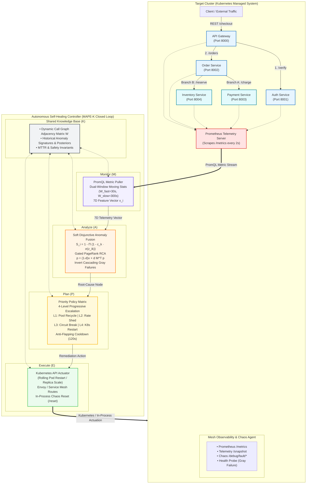

# System Architecture: Autonomous Self-Healing Distributed Backend System

This document provides the high-level and detailed architecture of the Autonomous Self-Healing Microservices Mesh.

An interactive hand-drawn diagram file is provided in this repository at:
**[`docs/architecture.excalidraw`](./architecture.excalidraw)**

You can view and edit it by:
1. Dragging and dropping [`architecture.excalidraw`](./architecture.excalidraw) into [excalidraw.com](https://excalidraw.com).
2. Opening it directly in VS Code / Cursor using the **Excalidraw extension**.

---

## 1. Complete System Architecture Diagram

---

## 2. Key Architectural Layers

### A. Target Cluster (5-Microservice Branching DAG)
- **`api-gateway` (Port 8000)**: Ingress orchestrator that validates requests and initiates downstream calls.
- **`auth-service` (Port 8001)**: High-throughput authentication verification.
- **`order-service` (Port 8002)**: Multi-branch business logic coordinator.
- **`payment-service` (Port 8003)**: Financial capture leaf node (Branch A).
- **`inventory-service` (Port 8004)**: Stock reservation leaf node (Branch B).

### B. Observability & Chaos Injection
Every service incorporates uniform telemetry and fault injection:
- `/metrics`: Prometheus exposition of p50, p95, p99 latencies, request counts, errors, and in-flight concurrency.
- `/telemetry/snapshot`: Real-time JSON telemetry diagnostics.
- `/debug/fault/*`: In-process fault injection (latency, CPU burn, memory leaks, thread starvation, error spikes).
- `/health`: Naive Kubernetes liveness probe (used to demonstrate gray failure blind spots).

### C. MAPE-K Closed-Loop Controller
1. **Monitor (M)**: Ingests 7D telemetry vector $\vec{x}_i \in \mathbb{R}^7$ across sliding windows ($W_{\text{fast}}=30\text{s}$, $W_{\text{slow}}=300\text{s}$).
2. **Analyze (A)**: Fuses dimensional anomalies using soft disjunctive fusion ($S_i$) and isolates root causes via Gated Correlation PageRank ($\mathbf{p} = (1-d)\mathbf{v} + d\mathbf{M}^T\mathbf{p}$).
3. **Plan (P)**: Evaluates a 4-level progressive escalation matrix with an anti-flapping cooldown timer ($120\text{s}$).
4. **Execute (E)**: Actuates remediation through the Kubernetes API and dynamic service mesh traffic controls.
5. **Knowledge Base (K)**: Persists mesh topology, fault history, and safety policies.
